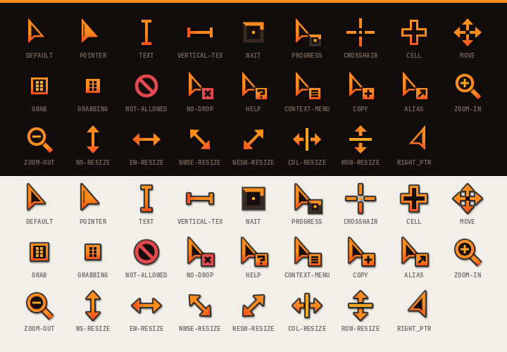
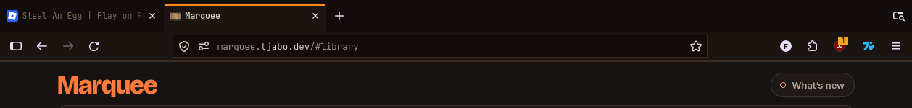
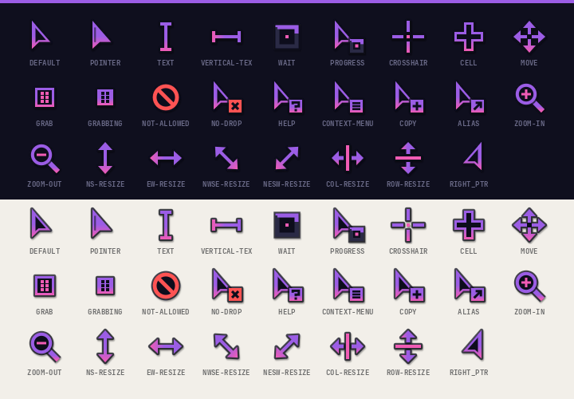
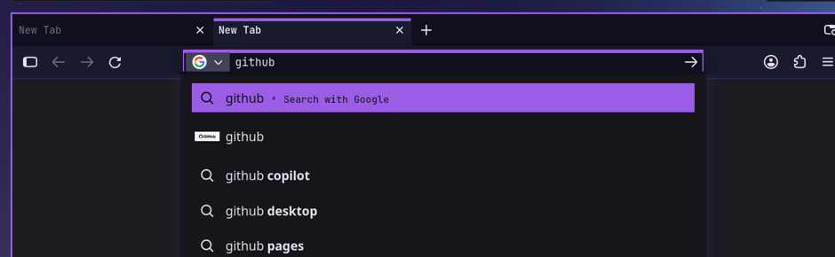
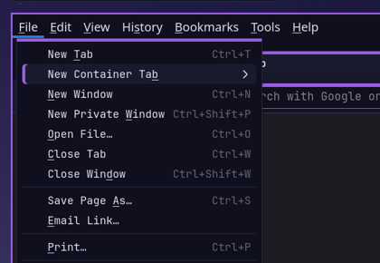
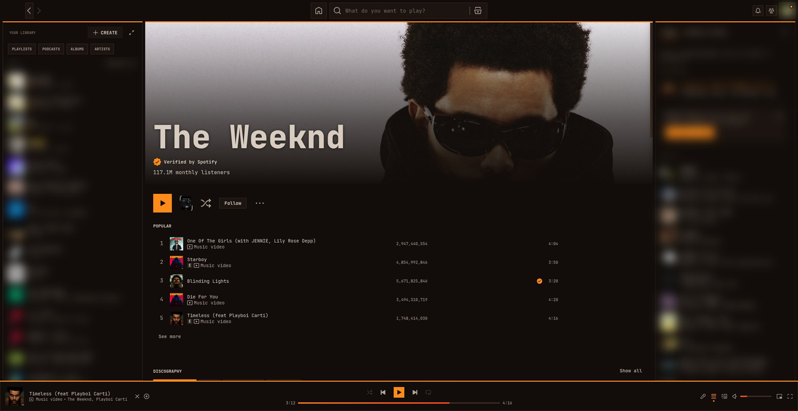
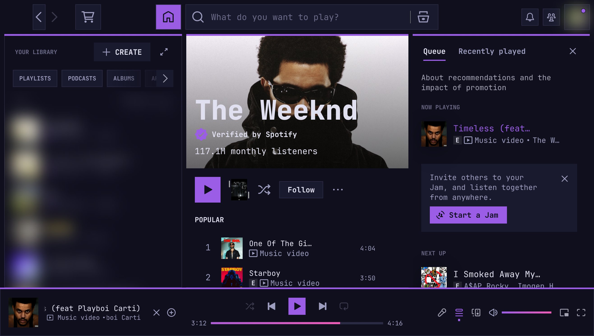

# deckskin

[](https://github.com/Tjabooo/deckskin/actions/workflows/ci.yml) [](https://github.com/Tjabooo/deckskin/releases) [](LICENSE)

Turn a small palette file into a matching **mouse cursor theme** (Xcursor + hyprcursor), **Firefox theme** and
**Spotify theme**, all in a flat, square "deck" style: dark panels, a 3px accent bar on top, solid accent chips.











## Features

- **Cursor theme** with 26 shapes and 95 aliases (CSS names, X11 names, the Qt/GTK hash names), so apps
  don't fall back to another theme.
  - The default arrow is a dark wedge with an accent outline and a thicker accent bar down its straight edge.
    Link hover turns it into a solid accent "chip". `wait` and `progress` animate a segment running round a
    square track.
  - Built as **Xcursor** (sizes 24–96, for XWayland, GTK and Qt) and **hyprcursor** (SVG, sharp at any
    scale on Hyprland), in one theme folder.
  - A halo and a soft shadow keep every shape readable on light pages and on accent-coloured UI.
- **Firefox theme** (`userChrome.css` + `userContent.css`, works on release Firefox without signing):
  - Tabs: the selected tab is a panel with a 3px accent bar on top and runs straight into the nav bar.
  - Square address bar; the selected result is a solid accent row and hovered results get an accent left edge.
  - Menus and panels get a 3px accent bar on top, with an accent left edge on hover. Tooltips, the link status
    bar, the find bar and the sidebar are styled too.
  - New tab page, `about:` pages (settings, add-ons) and reader view use the palette.
  - Text selection uses the accent colour, and the dark background removes the white flash while pages load.
- **Spotify theme** (a [Spicetify](https://spicetify.app) theme):
  - Square panels with a 3px accent bar, one font throughout, and small uppercase tags for section headings.
  - Solid accent play buttons and selected filter chips; everything else is outlined. Hovered and selected rows
    get an accent left edge, and the seek and volume bars run from `accent` to `deep`.
  - Spotify's colours taken from the album art are gone: playlist pages, lyrics and Browse tiles stay on the
    palette, while the art itself and artist photos stay.
- **One palette per rice.** Each palette is a TOML file with eleven colours and a font. Two ship with deckskin:
  `ember` (charcoal + orange) and `neon` (navy + violet/pink).

## Requirements

- Python 3.11+ with Pillow (`python-pillow`)
- `rsvg-convert` (librsvg)
- `hyprcursor-util` (hyprcursor) for the hyprcursor build. If it's missing, you get Xcursor only.
- Firefox, any recent release (tested on 159)
- For the Spotify theme: [Spicetify](https://spicetify.app) and a Spotify install it can write to (tested on
  Spicetify 2.46.4 with Spotify 1.3.4). `install` skips this part if either is missing, unless you pass `--spotify`.

## Install

```sh
git clone https://github.com/Tjabooo/deckskin && cd deckskin
./deckskin install ember                    # cursor + Firefox theme
./deckskin install neon --cursor            # just the cursor
./deckskin install ember --firefox --restart-firefox
./deckskin install neon --spotify --restart-spotify
```

`install` does the following:

| Part | Where |
| --- | --- |
| Cursor theme | `~/.local/share/icons/<Name>-Deck/` (Xcursor `cursors/` + `hyprcursors/`) |
| Default cursor for X11/XWayland | `~/.icons/default/index.theme`, `~/.local/share/icons/default/index.theme` |
| GTK | `gtk-cursor-theme-name/size` in `~/.config/gtk-{3,4}.0/settings.ini`, `gsettings` cursor-theme/size |
| Session | `XCURSOR_*`/`HYPRCURSOR_*` pushed to systemd + D-Bus activation env; `hyprctl setcursor` when on Hyprland |
| Firefox | `chrome/userChrome.css` + `chrome/userContent.css` in your default profile, a marked block in `user.js` |
| Spotify | `Themes/<Name>-Deck/` in Spicetify's config folder, selected in `config-xpui.ini` and applied to Spotify |

To keep the cursor after a re-login, set it in your compositor config. For Hyprland:

```lua
hl.env("XCURSOR_THEME", "Ember-Deck")
hl.env("HYPRCURSOR_THEME", "Ember-Deck")
```

(or `env = XCURSOR_THEME,Ember-Deck` / `env = HYPRCURSOR_THEME,Ember-Deck` in `hyprland.conf`).
Apps that are already open keep their old cursor until they restart.

Firefox loads the theme only at startup. With `--restart-firefox`, deckskin closes Firefox gracefully,
switches the base theme to the built-in Dark one and starts it again. Your tabs come back even if Firefox
normally opens to the home page. Without the flag, just restart Firefox yourself.

Spotify also needs a restart to load its theme: `--restart-spotify` closes it, reopens it with the same flags and
resumes playback if it was playing.

**Spotify updates remove the theme**, because they replace the files Spicetify patched. Run
`./deckskin spotify-reapply` afterwards. Or install with `--watch`, which adds a systemd user unit
(`deckskin-spotify.path`) that does this for you and sends a notification. It's off unless you ask for it.

Before anything gets overwritten, a copy goes to `~/.local/share/deckskin/backups/`.

## Usage

```sh
./deckskin build ember --out dist           # build everything into dist/ember/ without installing
./deckskin preview neon --out neon.png      # cursor contact sheet
```

## Configuration: make your own palette

Copy `palettes/ember.toml`, change the colours, and pass either its name (if it sits in `palettes/`) or its path:

```toml
name = "Ember"            # theme becomes "Ember-Deck"

[colors]
bg        = "#120d0a"     # window / page background
panel     = "#1b1410"     # raised surfaces: nav bar, selected tab, hover
line      = "#3a2c22"     # 1px borders, spinner track
fg        = "#d8cbbf"     # text
subtext   = "#b2a397"     # secondary text
dim       = "#7a675a"     # labels, inactive tabs
accent    = "#ff8c1a"     # 3px bars, chips, cursor outline
accent2   = "#f5a524"     # highlights, cursor details
deep      = "#ff4d1f"     # gradient end
alert     = "#e5484d"     # not-allowed / no-drop
on_accent = "#120d0a"     # text on a solid accent chip

[font]
ui = "JetBrainsMono Nerd Font"   # Firefox tabs, address bar, menus; all of Spotify
```

## How it works

- `deckskin_cursor.py` draws each shape as SVG on a 24-unit grid, so edges land on whole pixels at 24 px.
  `rsvg-convert` renders every size. The Xcursor files are written directly (premultiplied ARGB with an
  image per size/frame, aliases as symlinks), and the same SVGs plus a `meta.hl` per shape go through
  `hyprcursor-util --create`.
- `deckskin_firefox.py` fills a CSS template with the palette. It mostly overrides Firefox's own CSS
  variables (`--panel-background-color`, `--urlbar-border-radius`, `--tab-selected-bgcolor`, …) as
  `!important` user styles, which beat the inline values lightweight themes set. Firefox ignores
  `::part(content)` from user sheets, so the accent bar on menus comes in as a background layer instead.
- `deckskin_spotify.py` writes a Spicetify `color.ini` and `user.css`. The selectors stick to names that survive
  Spotify releases: `Root__*`, `data-testid`, `data-encore-id` and Spicetify's mapped classes. Spotify tints pages
  by setting CSS variables inline, so the theme overrides those with `!important`. The "now playing" bars are a
  green GIF, so a `hue-rotate` computed from the accent recolours them.
- Changing the base theme edits `extensions.json` and `prefs.js` while Firefox is closed. The addon startup
  cache gets deleted, and Firefox rebuilds it.

## Uninstall

```sh
rm -r ~/.local/share/icons/*-Deck
# then remove chrome/userChrome.css, chrome/userContent.css and the "deckskin" block in user.js
# from your Firefox profile, or restore them from ~/.local/share/deckskin/backups/
systemctl --user disable --now deckskin-spotify.path   # only if you used --watch
spicetify restore                                      # puts Spotify back to stock
```

## License

MIT
